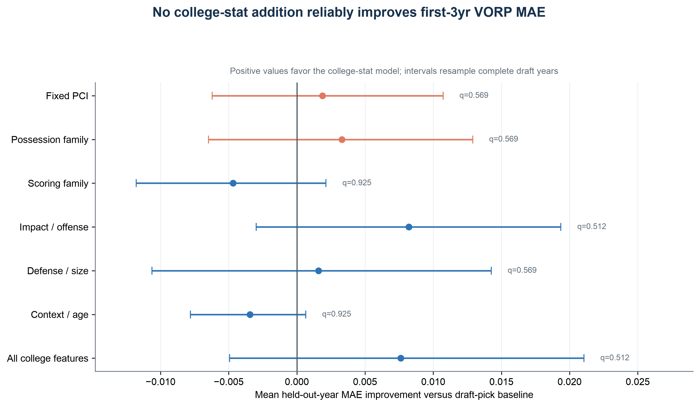

# NBA Draft Value: What College Stats Can Tell Us

Can college basketball statistics help identify players who will outperform their NBA draft position?

This project studies **896 players drafted from 2009–2023**, including **682 players matched to college statistics**. It focuses on steals, offensive rebounds, turnovers, and assists: the smaller contributions that help teams gain, keep, and use possessions.

**Main finding:** These college stats have a weak relationship with later NBA value. Adding them to a model that already knows draft position produces small improvements, but those improvements are not statistically reliable across draft classes.

## Findings

1. **Draft position already tells us a lot.** Earlier picks generally produce more NBA value, making pick number a useful starting point for predictions.
2. **Possession skills show a small signal.** Players with stronger possession profiles tend to outperform their draft slot slightly more often, but there are many exceptions.
3. **The clearest possession patterns appear among forwards.** Small forwards and power forwards show the most promising relationships. These patterns need further testing before claiming the effect differs by position.
4. **More college stats do not guarantee better predictions.** Much of their information overlaps with draft position and with other college stats. Broad impact and offense measures show the clearest small unique contribution, but that result does not hold up under the alternative outcome tested.
5. **Player maps help find statistical comparisons.** The similarity plots show players with similar college profiles; they do not establish clear future-star or bust groups.

The practical takeaway is to use possession stats as another piece of scouting evidence. The results do not establish that NBA teams consistently undervalue possession creators.

## What the project measures

### NBA value and draft surplus

**VORP (Value Over Replacement Player)** is a box-score estimate of a player's overall NBA contribution relative to a replacement-level player. Higher values indicate more contribution.

For the exploratory analysis:

```text
Draft surplus = Player's peak three-year average VORP
                − Average peak three-year VORP for that draft slot
```

A positive surplus means the player outperformed the historical average for their pick. A negative surplus means they underperformed it.

For example, if a player's peak average VORP is 2.0 and the average for their draft slot is 0.8, their surplus is **+1.2**. This is an illustrative example, not a specific player's result.

### Possession Creation Index (PCI)

PCI combines four college statistics into one score:

| College statistic | Basketball meaning | Effect on PCI |
|---|---|---|
| Steal rate | Win the ball back | Increases the score |
| Offensive rebound rate | Give the team another shot opportunity | Increases the score |
| Turnover rate | Lose a scoring opportunity | Decreases the score |
| Assist rate | Help create shots for teammates | Increases the score |

Assists reflect productive playmaking; they do not literally create an extra possession.

```text
PCI = 1.0 × z(steal rate) + 0.8 × z(offensive rebound rate)
      − 1.0 × z(turnover rate) + 0.6 × z(assist rate)
```

Here, `z` puts each statistic on a comparable scale relative to the sample average. The weights are fixed, theory-based choices. During model evaluation, scaling uses only the training data.

## What the results show

### A weak relationship with draft surplus

Across the 682 college-matched players, PCI's correlation with surplus is **r = 0.185**. Correlation ranges from −1 to +1; this small positive value means a weak tendency, with substantial variation between players.

| Position | Players with college data | PCI correlation with surplus |
|---|---:|---:|
| Point guard (PG) | 126 | 0.139 |
| Shooting guard (SG) | 188 | 0.186 |
| Small forward (SF) | 119 | 0.245 |
| Power forward (PF) | 163 | 0.199 |
| Center (C) | 86 | 0.075 |

Small forwards have the strongest estimated relationship, and centers the weakest. These are descriptive comparisons, not proof that the effects differ between positions. Uncertainty and adjusted significance tests are available in the [full report](reports/NBA_Draft_Possession_Position_Report.md).

### Small improvements in predictions for held-out draft classes

The main prediction test uses **average VORP in the first three post-draft seasons**, counting a season not played as zero. This gives players the same amount of time to produce value.

| Model | Average prediction error (MAE) |
|---|---:|
| Draft pick only | 0.3824 |
| Draft pick + PCI | 0.3802 |
| Draft pick + broader possession stats | 0.3789 |
| Draft pick + scoring stats | 0.3874 |
| Draft pick + impact/offense stats | 0.3742 |
| Draft pick + all college stats | 0.3749 |

**Lower MAE is better.** Adding possession stats reduces error by about **0.0035 VORP, or 0.9%**. None of the additions reliably beats draft pick alone after adjusting for multiple comparisons.

The project also tests each stat family's contribution by removing it from the full model. Only impact/offense shows a statistically detectable unique benefit in the first-three-year test, and that benefit is small. No comparison remains significant when predicting the best three-year stretch within the first five seasons.



The chart shows how much each addition reduces error. A range crossing zero means the data are compatible with either an improvement or a worsening. Read the [evaluation details](EVALUATION_grouped_nested_cv.md) for the complete results.

## How the analysis works

1. Collect NBA draft records and season statistics from Basketball Reference.
2. Match players to their final pre-draft college season from BartTorvik.
3. Build PCI and groups of possession, scoring, impact/offense, defense/size, and context/age statistics.
4. Describe relationships with NBA outcomes, both overall and by position.
5. Hold out one entire draft class at a time, train on the remaining classes, and compare predictions with a draft-pick-only model.
6. Build t-SNE maps to visualize similar college profiles. Clusters and nearest neighbors are calculated from the underlying statistics, not from the map coordinates.

Model settings are selected within the training classes. Missing-value handling, scaling, and the draft-pick baseline also use only training data, keeping the held-out class out of those decisions.

## Run the project

Use **Python 3.10 or newer** and run commands from the project folder.

```bash
python3 -m venv .venv
source .venv/bin/activate
python3 -m pip install -r requirements.txt
```

The saved data let you rerun the analysis without collecting everything again:

```bash
python3 03_grouped_nested_cv.py
python3 05_position_analysis.py
python3 04_tsne_similarity_clusters.py
python3 06_build_scientific_report.py
```

To rebuild the input datasets first:

```bash
python3 01_collect_draft_data.py
python3 02_collect_college_stats.py
```

The collection scripts reuse saved season files where available. Downloading missing files requires internet access and may be blocked or rate-limited by the source websites.

## Where to find things

| File or folder | Purpose |
|---|---|
| `01_collect_draft_data.py` | Collect NBA draft and season data; calculate surplus |
| `02_collect_college_stats.py` | Match college data and build prospect statistics |
| `03_grouped_nested_cv.py` | Evaluate predictions on held-out draft classes |
| `04_tsne_similarity_clusters.py` | Create similarity maps and player comparisons |
| `05_position_analysis.py` | Produce position breakdowns and correlations |
| `06_build_scientific_report.py` | Build the detailed Markdown and PDF reports |
| `position_utils.py` | Assign positions and track assignment sources |
| `data/` | Source datasets, processed data, and result tables |
| `plots/` | Exploratory charts and player similarity maps |
| `reports/` | Detailed report and summary figures |

Read the [full findings](reports/NBA_Draft_Possession_Position_Report.md), view the [PDF report](output/pdf/NBA_Draft_Possession_Position_Report.pdf), or inspect the [position methodology](POSITION_METHOD.md).

## Limits to keep in mind

- **Coverage:** College data cover 682 of 896 drafted players. Findings may not generalize to international or other unmatched prospects.
- **Outcome:** VORP reflects role, minutes, injuries, and team context as well as ability.
- **Exploratory surplus:** Older players have more seasons in which to reach their peak. The surplus baseline also uses the full dataset, so predictive tests use separate outcomes with equal time windows.
- **Position:** The preferred label comes from a player's first NBA season, with college-based estimates for players who never appeared. Position is used for historical breakdowns, not as a predictive model input.
- **Other composite scores:** The Granular Prospect Index was fitted on this same cohort and outcome. Its correlations are exploratory, not independent validation.
- **Scope:** This is a retrospective study. It does not show that possession traits cause NBA success or provide a validated forecast for a future draft.

## Data sources

- [Basketball Reference](https://www.basketball-reference.com/) — draft history, NBA player identities, positions, and season VORP.
- [BartTorvik](https://barttorvik.com/) — college box-score and advanced statistics.

The reported results describe the saved 2009–2023 draft cohort, using NBA season data through 2025–26.
