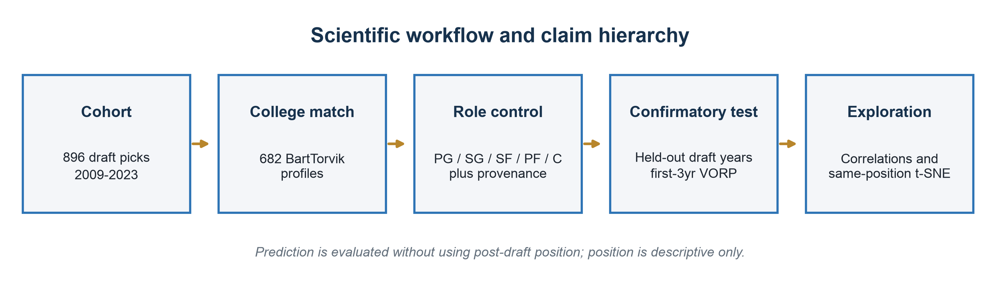
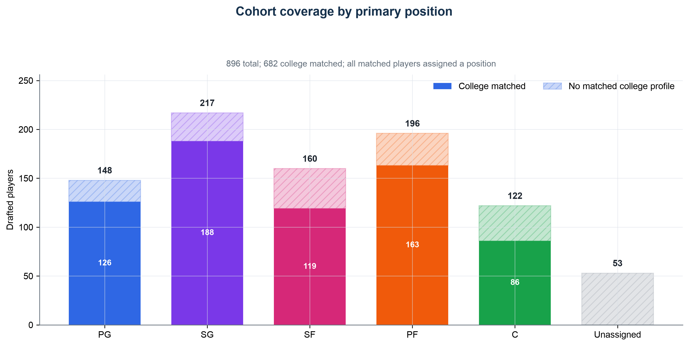
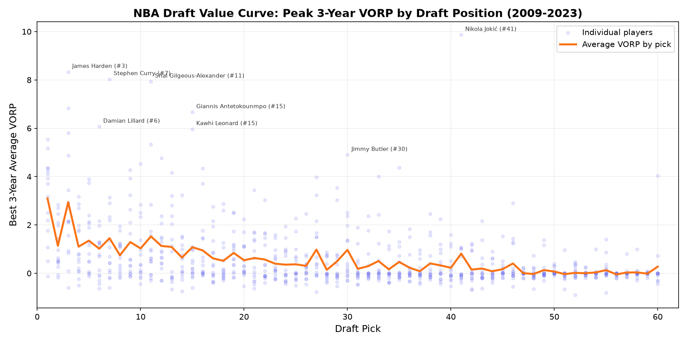
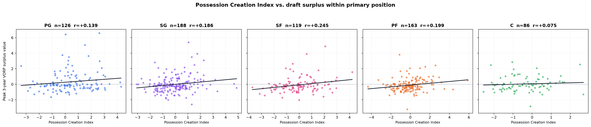
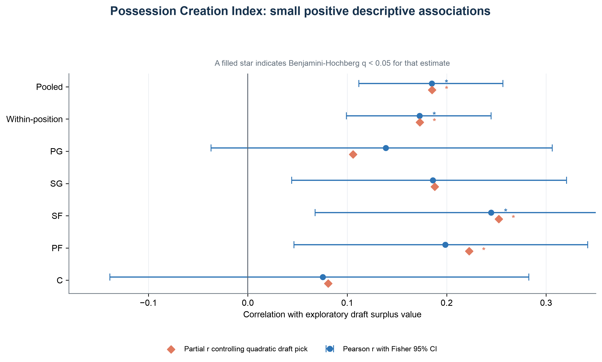
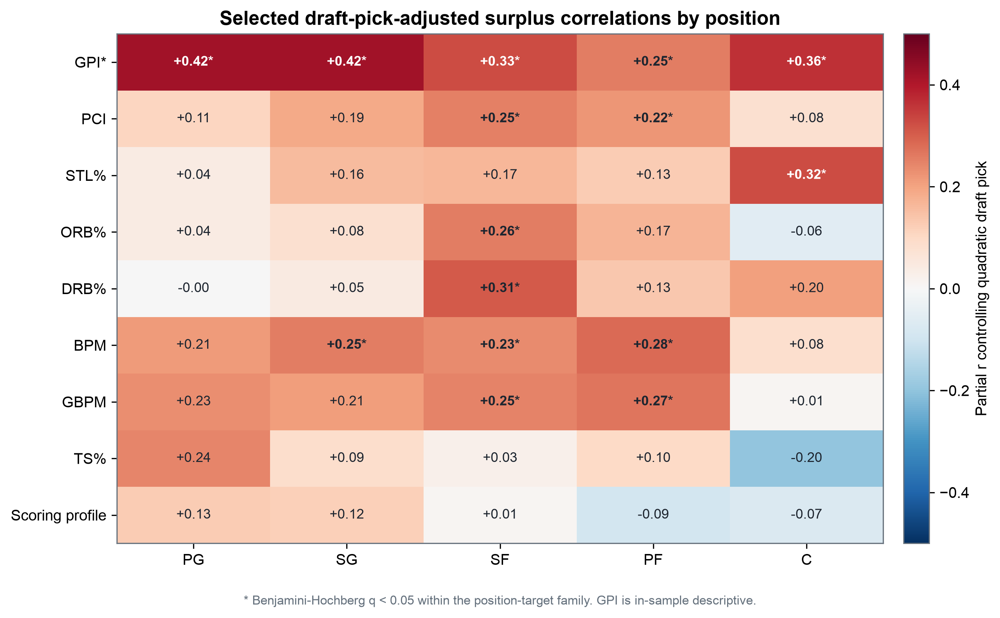
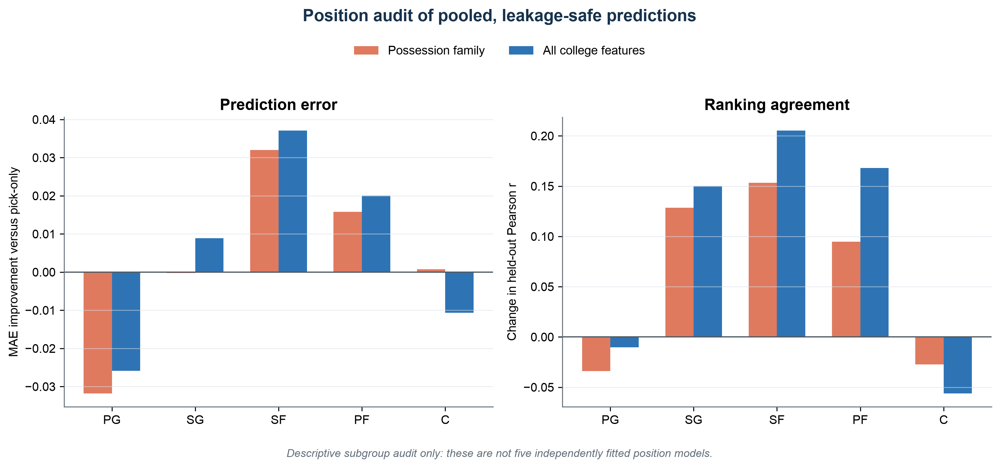
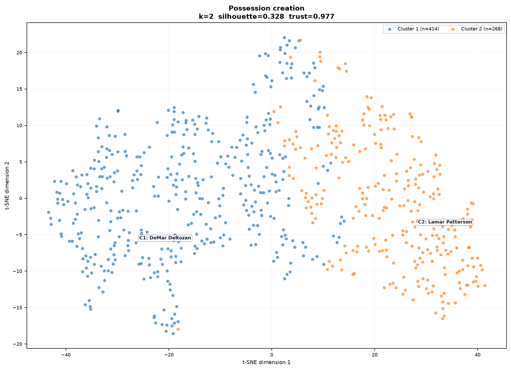
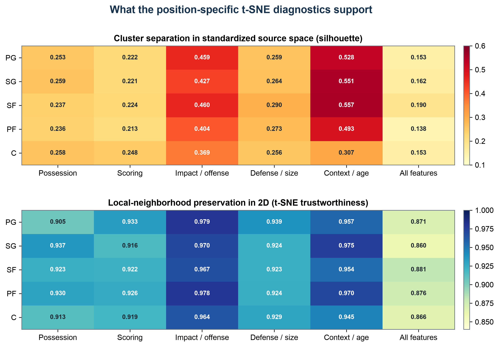
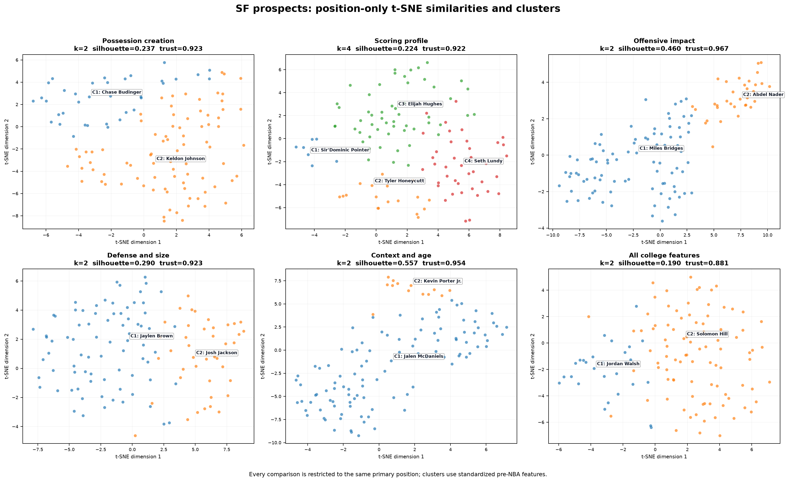

# Do College Possession-Economics Indicators Add Signal Beyond Draft Position?

## A position-stratified study of NBA draft classes, 2009-2023

Grouped nested validation and exploratory t-SNE maps of player archetypes  
Analysis date: 4 August 2026

> **Primary conclusion:** Possession-related college indicators contain a
> modest, position-dependent descriptive signal. They have not yet shown a
> reliable, practically large improvement beyond the information already
> summarized by draft position.

## Executive abstract

This retrospective study tests whether possession-related college statistics
add information beyond NBA draft position. The cohort contains 896 players
drafted from 2009 through 2023; 682 were matched to final pre-draft-season
BartTorvik profiles. The fixed Possession Creation Index (PCI) was weakly
associated with exploratory draft surplus (`r=.185`, 95% CI `.112` to `.257`).
The strongest position-specific point estimate was among small forwards
(`r=.245`).

In grouped nested evaluation of first-three-year VORP, adding the broader
possession family raised held-out correlation from `.351` to `.417` but reduced
MAE by only `.0035` VORP. The draft-year interval crossed zero (`-.0065` to
`.0129`; `q=.569`). Broad impact/offense measures supplied the clearest, though
still small, unique early-career contribution. Position audits suggested that
college information helped most for shooting guards, small forwards, and power
forwards. t-SNE preserved local same-position neighborhoods but showed weak
all-feature cluster separation. The evidence supports a modest role-dependent
possession-economics signal, not a strong universal draft-market inefficiency.



## 1. Research question and scientific method

### 1.1 Observation

Prospect discussion often emphasizes scoring volume and shot creation. A
competing basketball hypothesis is that gaining extra opportunities, avoiding
lost opportunities, and converting possessions productively may be
underweighted. Draft position already summarizes much of the league's
information, so the stringent question is whether college possession
statistics add useful signal after draft position is known.

### 1.2 Question

Do possession-economics indicators from a player's final pre-draft college
season predict NBA value or draft surplus, and does that relationship vary
across PG, SG, SF, PF, and C roles?

### 1.3 Hypotheses

| Hypothesis | Test | Result |
|---|---|---|
| H1: PCI is positively associated with surplus within role. | Position Pearson and pick-adjusted partial correlations with BH q-values. | Partially supported descriptively. |
| H2: PCI or the possession family improves prediction beyond pick. | Grouped nested CV with draft-year MAE inference. | Not supported. |
| H3: possession effects differ by position. | Compare estimates and uncertainty; require an interaction test for confirmation. | Suggestive pattern only. |
| H4: same-position prospects form coherent feature archetypes. | Source-space silhouette and t-SNE trustworthiness. | Local comparables supported; crisp tiers not supported. |

The project was not preregistered. These hypotheses organize the completed
analyses rather than constituting a prospective preregistration.

## 2. Data and cohort construction

Basketball Reference supplies draft history, NBA player identifiers, season
positions, and VORP. BartTorvik supplies final pre-draft-season college
box-score and advanced statistics.

- Full cohort: 896 unique draft-year and pick records, 2009-2023.
- College-matched analytic sample: 682 players, or 76.1%.
- Matched position counts: PG 126, SG 188, SF 119, PF 163, C 86.
- Position source among matched rows: 647 direct NBA-entry labels and 35
  college-model fallbacks.
- Full cohort: 808 direct labels, 35 fallbacks, and 53 unassigned rows.



NBA season joins retain Basketball Reference player IDs, prefer combined
traded-team rows, and require the NBA career to begin after the draft year.
These rules prevent same-name collisions, including the two Marcus Thornton
and two Justin Jackson records.

The preferred position is the first recorded NBA position in a season with
games played. Players without an NBA appearance receive a regularized
five-position estimate from pre-NBA height, BartTorvik role, and college
statistics. The probabilities rank ambiguity but are not calibrated.

> **Leakage warning:** First-NBA-season position is post-draft information. It
> is used only to describe historical role differences and audit predictions.
> It is never passed into the leakage-safe predictive model.

## 3. Operational definitions

### 3.1 What "possession" means here

Possession does not mean pace, touches, or time of possession. It denotes
pre-NBA indicators associated with gaining opportunities, retaining them, or
converting them productively. Steals and offensive rebounds gain opportunities;
turnovers surrender them; assists proxy playmaking and shot creation but do not
literally create an extra team possession.

The fixed Possession Creation Index is:

```text
PCI = 1.0 * z(STL%) + 0.8 * z(ORB%) - 1.0 * z(TO%) + 0.6 * z(AST%)
```

The weights are theory-driven. In cross-validation, medians, means, standard
deviations, and PCI construction are fitted only inside the training fold.

The broader possession family contains `ORB%`, `AST%`, `TO%`, `STL%`,
assist-to-turnover ratio, offensive rebounds, assists, and steals. PCI is a
compact theory score; the broader family lets ridge regression learn the
training-data contribution of each related measure.

### 3.2 Outcomes

| Outcome | Definition | Inferential role |
|---|---|---|
| First-3yr VORP | Mean VORP in the first three post-draft seasons, inserting zero for a season not played. | Primary common-horizon predictive outcome; `n=682`, 15 drafts. |
| Best-3yr VORP in first five | Best three-season mean within the first five post-draft seasons. | Sensitivity outcome; `n=596`, 2009-2021 drafts. |
| Peak 3yr VORP | Best three consecutive NBA seasons across the locally observed career. | Exploratory; older cohorts have longer opportunity windows. |
| Draft surplus | Peak 3yr VORP minus the full-sample mean for the exact draft slot. | Exploratory target; not used in grouped prediction. |



## 4. Statistical methods

### 4.1 Descriptive correlations

For every target and each position, pooled sample, and within-position-centered
sample, the analysis reports:

- Pearson `r` with a Fisher-transformed 95% confidence interval;
- Spearman `r`;
- partial `r` after controlling a quadratic draft-pick basis; and
- Benjamini-Hochberg false-discovery-adjusted q-values within each
  position-target set.

Separate significance in one position but not another is not a formal
between-position interaction test.

### 4.2 Grouped nested prediction

1. The outer loop leaves one complete draft class out for testing.
2. Five-fold GroupKFold over the remaining draft years selects ridge alpha.
3. Draft-pick splines, imputation, missing indicators, scaling, and PCI
   standardization are fitted on training rows only.
4. Candidate models add fixed PCI, one basketball feature family, or all
   college features to a nonlinear draft-pick baseline.
5. Inference uses draft-year MAE differences, a 20,000-repeat year-cluster
   bootstrap interval, an exact one-sided sign-flip test, and BH correction.

Raw VORP is predicted directly. Stored surplus value is not used because its
expected-pick curve was calculated from the full sample.

### 4.3 t-SNE, clustering, and neighbors

Each family is median-imputed with missing indicators and standardized.
K-means selects `k=2..8` by the best silhouette score in standardized source
space with `n_init=25`. Nearest neighbors are also calculated in source space.
t-SNE supplies only the two-dimensional display, using PCA initialization,
automatic learning rate, seed 42, and perplexity 30 subject to a sample-size
cap. Every position-only map is refitted within a single role.

> t-SNE axes, rotations, and global distances have no direct basketball
> meaning. Cluster colors describe feature-space groups, not NBA success.
> High trustworthiness supports local visual comparison; it does not validate
> K-means or prove predictive value.

## 5. Results

### 5.1 Descriptive possession associations

Across all 682 matched players, PCI correlates `.185` with exploratory draft
surplus (95% CI `.112` to `.257`). Centering within position leaves `r=.173`
(`.099` to `.245`). The bivariate squared correlations are roughly 3-4%, which
is evidence of a tendency rather than strong individual-player discrimination.



| Position | n | PCI r (95% CI) | Pearson q | Pick-adjusted partial r | Partial q |
|---|---:|---:|---:|---:|---:|
| PG | 126 | `.139 (-.037, .306)` | `.290` | `.106` | `.603` |
| SG | 188 | `.186 (.044, .321)` | `.091` | `.188` | `.084` |
| SF | 119 | `.245 (.068, .407)` | `.037` | `.252` | `.027` |
| PF | 163 | `.199 (.046, .342)` | `.086` | `.223` | `.031` |
| C | 86 | `.075 (-.139, .283)` | `.728` | `.081` | `.682` |



Only SF clears the FDR threshold for the unadjusted PCI correlation. SF and PF
clear it after draft-pick adjustment. This does not establish that either
coefficient differs statistically from another position.

### 5.2 Position-specific texture



- PG: general impact and efficiency measures exceed PCI.
- SG: GPI and BPM lead; broad college information improves held-out ranking.
- SF: defensive rebounding, offensive rebounding, and PCI form the clearest
  possession-related pattern.
- PF: two-way impact and PCI retain modest pick-adjusted relationships.
- C: aggregate PCI is weak; steal rate is the more promising disruption
  measure. Mobility was not measured.

The Granular Prospect Index is positive at every position (`r=.260` to `.466`),
but its weights were fitted on the same 2009-2023 cohort and outcome. It is
descriptive, not held-out evidence. The threshold scoring profile is weak:
pooled surplus `r=.066`, within-position `r=.043`, and no position clears FDR.

### 5.3 Main predictive test

| Model | MAE | RMSE | Held-out r | MAE gain vs pick | q |
|---|---:|---:|---:|---:|---:|
| Draft pick only | `.3824` | `.5942` | `.351` | - | - |
| Pick + fixed PCI | `.3802` | `.5807` | `.407` | `.0022` | `.569` |
| Pick + possession | `.3789` | `.5778` | `.417` | `.0035` | `.569` |
| Pick + scoring | `.3874` | `.5927` | `.358` | `-.0049` | `.925` |
| Pick + impact/offense | `.3742` | `.5679` | `.449` | `.0083` | `.512` |
| Pick + defense/size | `.3809` | `.5811` | `.402` | `.0016` | `.569` |
| Pick + context/age | `.3861` | `.5944` | `.350` | `-.0036` | `.925` |
| Pick + all college | `.3749` | `.5689` | `.449` | `.0076` | `.512` |


Every add-beyond-pick interval crosses zero. The possession family improves 10
of 15 held-out years but reduces pooled MAE by less than 1% of baseline MAE.
Its year-clustered interval is `-.0065` to `.0129`, with `q=.569`.

### 5.4 Unique contribution and sensitivity

Restoring impact/offense to an ablated full model gives a small detectable
benefit: mean year MAE gain `.0057` (95% CI `.0020` to `.0094`; `q=.029`).
Restoring possession is suggestive but misses the threshold: `.0043` (`-.0009`
to `.0085`; `q=.092`). No comparison survives correction on the best-three-year
within first-five sensitivity outcome.

### 5.5 Position audit of held-out predictions



The all-feature model changes held-out `r` as follows:

- SG: `.191` to `.341`
- SF: `.124` to `.330`
- PF: `.409` to `.577`
- PG: `.530` to `.519`
- C: `.400` to `.344`

The possession family lowers MAE most for SF (`.3862` to `.3542`) and PF
(`.3518` to `.3360`), is nearly flat for SG and C, and is worse for PG. These
are pooled out-of-fold models audited by subgroup, not five independently
fitted role models and not subgroup hypothesis tests.

### 5.6 What t-SNE reveals



The pooled possession-family map has silhouette `.328` and trustworthiness
`.977`. Position-only possession silhouettes are only `.236-.259`, while
all-feature silhouettes are weaker at `.138-.190`. The result supports smooth
local neighborhoods and same-position comparables, not crisp natural talent
classes.



Impact/offense and context/age separate more clearly than possession or all
features. Context/age clusters likely reflect experience, minutes, and age
rather than latent talent.



## 6. Discussion and takeaways

1. Position splitting reduces role confusion. The pooled PCI signal remains
   after within-position centering, but its strength is not uniform in the
   point estimates.
2. Possession is more informative as a family of behaviors than as a single
   universal score. SF and PF merit the clearest follow-up.
3. Draft position is a formidable baseline because it already embeds scouting,
   measurements, medical information, and team beliefs.
4. General impact/offense measures carry the strongest small early-career
   signal. This is not the same as saying scoring volume is the answer; the
   threshold scoring profile performs poorly.
5. t-SNE is useful as a retrieval tool for same-position comparables. It does
   not add a prospect ranking.

The evidence does not justify the claim that the NBA draft market
systematically undervalues possession creators at every position. A narrower
statement is supported: possession-related college indicators show a modest
association with later surplus, and the most promising descriptive patterns
occur among wings and power forwards. Incremental predictive value beyond
draft position remains uncertain.

## 7. Shortfalls and threats to validity

- The study is observational and cannot show that possession traits cause NBA
  success or that teams ignored them.
- Only drafted, college-matched players enter the main analysis. International
  players and unmatched prospects create selection bias.
- VORP is box-score and opportunity dependent and reflects health, role,
  coaching, team context, and minutes.
- Zero-filled early seasons combine ability with injury, stashing, roster
  access, and development choices.
- Exploratory peak VORP gives older cohorts longer opportunity windows; exact
  slot surplus is estimated from the same complete sample.
- Historical entry position is post-draft and collapses hybrid roles into one
  label.
- The 35 position-model probabilities are not calibrated; centers have only
  86 matched observations.
- PCI weights are theory-driven and require external validation.
- GPI is fitted on this cohort and is not held-out evidence.
- Leave-one-year-out validation can train on seasons later than the test class;
  rolling-origin validation would better simulate real-time forecasting.
- Position differences are descriptive; formal feature-by-position
  interaction tests remain future work.
- The work was not preregistered, and BH correction is local to each analysis
  family.
- t-SNE is sensitive to scaling, imputation, seed, perplexity, and sample
  composition. No multi-seed or multi-perplexity stability analysis is
  reported.
- K-means assumes roughly spherical groups, and choosing `k` on the same sample
  can overstate apparent separation.

## 8. Conclusion and next experiments

Possession-economics indicators pass the weakest test: they have a positive
descriptive relationship with later draft surplus. They do not yet pass the
stronger test of a reliable, practically large improvement beyond draft
position in unseen draft classes. Broader impact/offense variables show the
clearest small unique early-career contribution, while t-SNE reveals local
statistical archetypes rather than stable talent tiers.

Priority next steps:

1. Freeze PCI and all analytic choices, then evaluate prospectively without
   refitting the formula.
2. Use rolling-origin validation.
3. Add pre-draft measurements, age curves, injuries, league strength, and
   authoritative pre-draft positions inside each training fold.
4. Fit and directly test penalized feature-by-position interactions.
5. Check t-SNE and clustering stability across seeds, perplexities, resamples,
   and alternative clustering methods.
6. Evaluate prospect rank lift, top-k hit rate, calibration, and scouting
   utility, not only MAE and correlation.

## 9. Reproducibility

Run in this order:

```text
python3 01_collect_draft_data.py
python3 02_collect_college_stats.py
python3 03_grouped_nested_cv.py
python3 05_position_analysis.py
python3 04_tsne_similarity_clusters.py --seed 42
python3 plot.py
python3 new.py
python3 06_build_scientific_report.py
```

Validation checks completed:

- 896 unique draft-year and pick records.
- 682 college-matched rows, all assigned exactly one position.
- No cross-position neighbors in position-only t-SNE output.
- All position t-SNE perplexities are below the relevant sample size.
- Fold-local target construction, baseline fitting, imputation, scaling, and
  PCI standardization in grouped nested CV.

The PDF report contains frozen output checksums and the full selected partial
correlation heatmap.

## References

1. Basketball Reference. NBA draft and player-season data. Local frozen
   extracts for draft classes 2009-2023 and locally available NBA seasons.
2. BartTorvik. College basketball advanced player statistics. Local frozen
   extracts for seasons 2009-2023.
3. van der Maaten L, Hinton G. Visualizing Data using t-SNE. *Journal of
   Machine Learning Research*. 2008;9:2579-2605.
4. Rousseeuw PJ. Silhouettes: A graphical aid to the interpretation and
   validation of cluster analysis. *Journal of Computational and Applied
   Mathematics*. 1987;20:53-65.
5. Davies DL, Bouldin DW. A Cluster Separation Measure. *IEEE Transactions on
   Pattern Analysis and Machine Intelligence*. 1979;PAMI-1(2):224-227.
6. Benjamini Y, Hochberg Y. Controlling the False Discovery Rate: A Practical
   and Powerful Approach to Multiple Testing. *Journal of the Royal
   Statistical Society, Series B*. 1995;57(1):289-300.
7. Hoerl AE, Kennard RW. Ridge Regression: Biased Estimation for Nonorthogonal
   Problems. *Technometrics*. 1970;12(1):55-67.
8. Pedregosa F, et al. Scikit-learn: Machine Learning in Python. *Journal of
   Machine Learning Research*. 2011;12:2825-2830.
